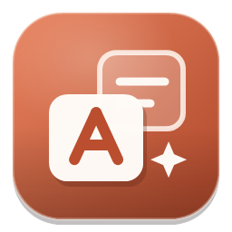
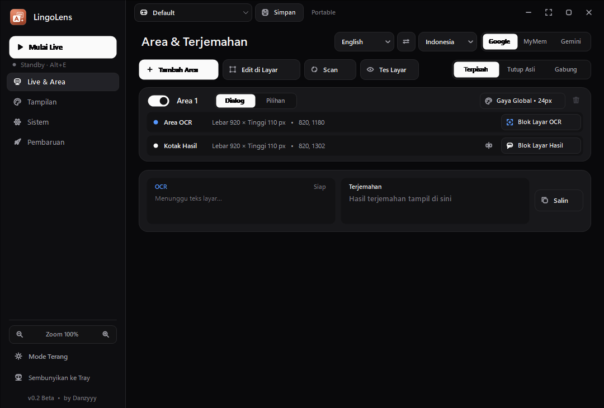

<div align="center">



# LingoLens

**Penerjemah Layar Game & Teks Real-Time untuk Windows (Native C#)**  
*Cepat, ringan, akurat, tanpa Python atau runtime tambahan.*

[](https://github.com/danzyyy19/LingoLens/releases/latest)
[](https://github.com/danzyyy19/LingoLens/releases/latest)
[](https://github.com/danzyyy19/LingoLens)
[](LICENSE)
[](https://github.com/danzyyy19)

<br/>

[**Download Terbaru**](https://github.com/danzyyy19/LingoLens/releases/latest) • [**Fitur Utama**](#-fitur-utama) • [**Tangkapan Layar**](#-tangkapan-layar) • [**Cara Pakai**](#-cara-pakai) • [**Build dari Source**](#-build-dari-source)

<br/>



</div>

---

## 📖 Tentang LingoLens

**LingoLens** adalah aplikasi penerjemah layar *real-time* ringan untuk Windows yang dirancang khusus untuk bermain game (RPG, Visual Novel, JRPG, petualangan, dll.) maupun membaca teks di layar secara langsung. Teks diambil secara instan menggunakan **Windows WinRT OCR** dan ditampilkan di atas game dalam bentuk overlay yang bersih, tembus klik (*click-through*), dan dapat dikustomisasi secara bebas per area.

> ⚡ **100% Native C# (.NET Framework 4.8 bawaan Windows)** — Tidak membutuhkan instalasi Python, runtime berat, atau hak akses Administrator. Langsung *plug-and-play*.

---

## 📥 Download

Unduh versi siap pakai melalui halaman resmi [**GitHub Releases**](https://github.com/danzyyy19/LingoLens/releases/latest):

| Versi | File Unduhan | Keterangan |
| :--- | :--- | :--- |
| **Portable** | [**`LingoLens-Portable.exe`**](https://github.com/danzyyy19/LingoLens/releases/latest/download/LingoLens-Portable.exe) | Langsung jalan tanpa install; konfigurasi & profil game tersimpan mandiri di folder yang sama. |
| **Installer** | [**`Setup-LingoLens.exe`**](https://github.com/danzyyy19/LingoLens/releases/latest/download/Setup-LingoLens.exe) | Pasang ke Windows dengan shortcut Start Menu, Desktop, dan Uninstaller lengkap. |
| **ZIP Paket** | [**`LingoLens-v0.2-beta-Windows-x64.zip`**](https://github.com/danzyyy19/LingoLens/releases/latest) | Paket arsip berisi Portable + README + Lisensi. |

---

## ✨ Fitur Utama

- 🔍 **WinRT OCR Cepat & Akurat** — Memanfaatkan mesin OCR bawaan Windows 10/11 secara *in-process* (sangat cepat ~30-50ms) ditambah *fallback OCR online* untuk bahasa yang paket bahasanya belum terinstal di Windows.
- 🔀 **Mode Dual-Area (Dialog & Pilihan)** — Pisahkan Area 1 untuk kotak teks dialog dan Area 2 untuk opsi pilihan respon game, sehingga opsi pilihan diterjemahkan rapi per baris (*line-by-line*) tanpa tercampur menjadi satu kalimat berantakan.
- 💬 **Terjemahan Natural Sehari-hari & Opsi Gemini AI** — Dilengkapi pra-pemrosesan ekspresi/idiom game dan gaya bahasa Indonesia santai yang luwes dan sopan (`NaturalTone`) agar hasil tidak kaku seperti robot, dengan dukungan **Google Translate**, **MyMemory**, serta opsional **Gemini AI**.
- 🛡️ **Glosarium & Kamus Nama Karakter** — Lindungi nama karakter, lokasi, atau istilah khusus game (misal: *Hyrule*, *Saria*, *Triforce*, atau `Master Sword=Pedang Master`) agar tidak diterjemahkan secara salah/harfiah.
- 🏷️ **Deteksi Nama Pembicara (*Speaker Badge*)** — Memisahkan otomatis tag nama karakter pembicara (misal: `Saria:`) dan menampilkannya sebagai badge warna tersendiri di atas kotak dialog.
- 🎨 **Pengaturan Tampilan Per-Area** — Atur font, ukuran huruf, perataan, warna, transparansi, outline, dan *Auto-Fit* secara independen untuk setiap area.
- 🎮 **Profil / Template per Judul Game** — Simpan dan muat ulang posisi area OCR, kotak hasil, serta gaya tampilan overlay berdasarkan judul game yang sedang dimainkan.
- 🌓 **UI Minimalis Dark & Light Mode** — Tampilan modern dan bersih dengan rendering teks native Windows ClearType, Zoom 75%–150%, Mode Layar Penuh (`F11`), serta dukungan System Tray.
- ⏱️ **Auto-Blank Idle** — Kotak overlay terjemahan otomatis menghilang saat tidak ada dialog baru di layar agar gameplay tetap bersih dan imersif.
- 🚀 **Pemeriksa Pembaruan Otomatis (*Auto-Update Checker*)** — Aplikasi secara senyap memeriksa rilis terbaru dari GitHub saat dibuka dan memunculkan banner notifikasi elegan jika ada versi baru yang dirilis oleh Danzyyy.

---

## 🕹️ Cara Pakai

1. Jalankan **`LingoLens-Portable.exe`** (atau instal via **`Setup-LingoLens.exe`**).
2. Buka game kamu dalam mode layar **Borderless Windowed** atau **Windowed**.
3. Klik **`Blok Layar OCR`** (`Alt+Q`) untuk menandai kotak dialog teks game di layar.
4. Klik **`Blok Layar Hasil`** (`Alt+A`) untuk menentukan di mana teks terjemahan ingin dimunculkan. *(Tekan `ESC` kapan saja untuk membatalkan blok layar).*
5. Tekan **`Mulai Live`** (`Alt+E`) dan mainkan game kamu seperti biasa.
6. Klik tombol **`Simpan`** di bar atas untuk menyimpan pengaturan posisi dan gaya untuk judul game tersebut.

### ⌨️ Pintasan Keyboard (Global Hotkey)

| Tombol | Fungsi |
| :--- | :--- |
| `Alt + E` | Mulai / Hentikan Penerjemahan Live |
| `Alt + Q` | Blok Area OCR di layar |
| `Alt + A` | Blok Kotak Hasil Terjemahan di layar |
| `Alt + W` | Mode Geser / Edit Kotak langsung di atas layar |
| `F11` | Mode Layar Penuh (Fullscreen Jendela Aplikasi) |
| `ESC` | Batalkan pemotretan / blok area layar |

---

## 🛠️ Build dari Source

Tidak membutuhkan Visual Studio atau .NET SDK — cukup gunakan compiler `csc.exe` bawaan Windows melalui PowerShell:

```powershell
git clone https://github.com/danzyyy19/LingoLens.git
cd LingoLens
.\build.ps1
```

Hasil biner akan otomatis dibuat di dalam folder `dist/`:
- `dist\LingoLens-Portable.exe`
- `dist\Setup-LingoLens.exe`
- `dist\LingoLens.exe`

---

## 📄 Lisensi

Dirilis di bawah lisensi terbuka [MIT](LICENSE) — Dibuat dengan bangga oleh **Danzyyy**.
