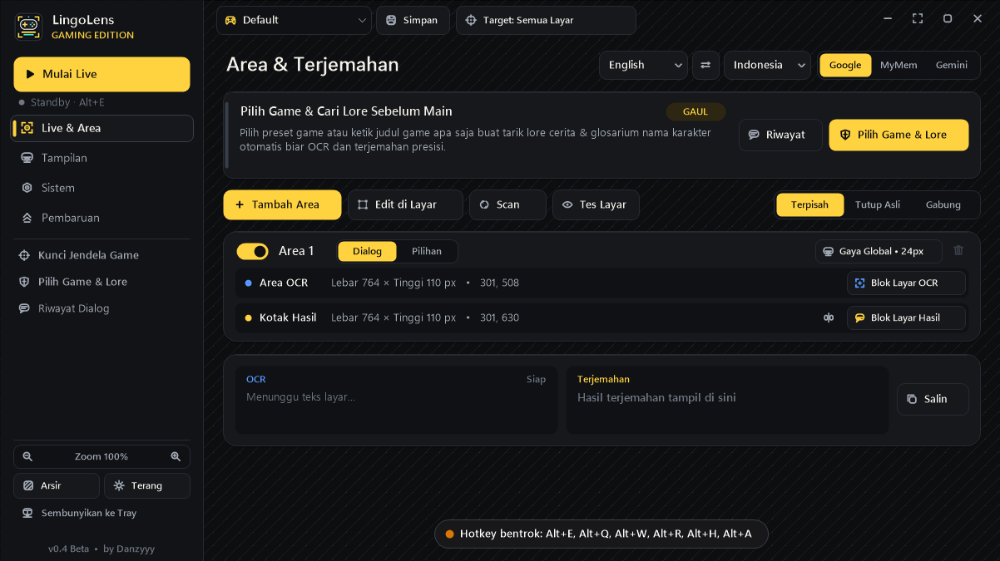
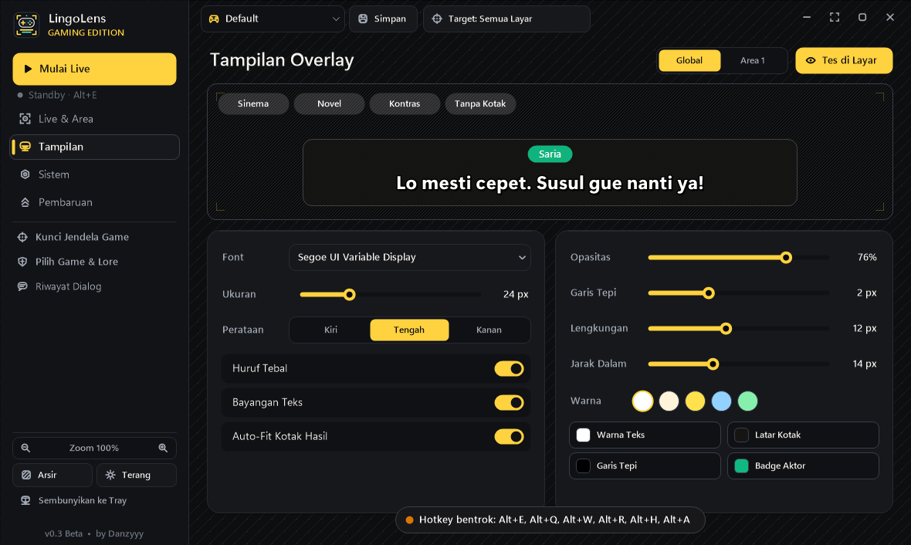
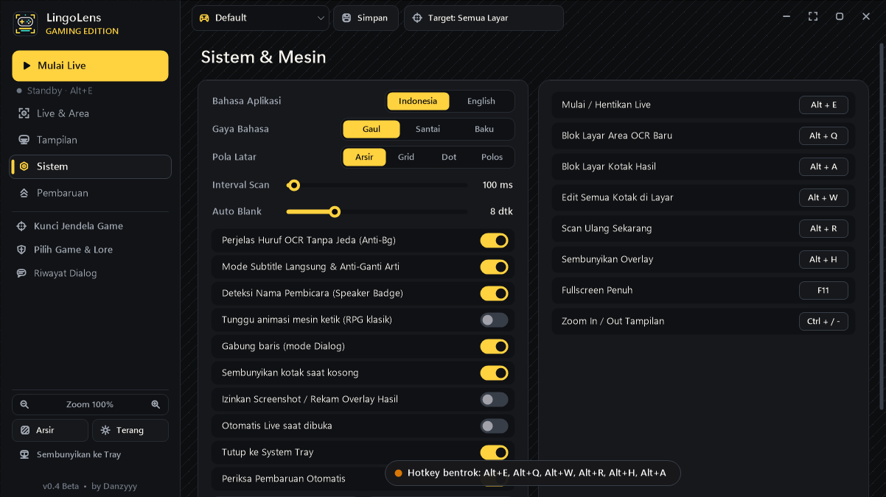

<p align="center">
  
</p>

<h1 align="center">LingoLens</h1>

<p align="center">
  Penerjemah subtitle dan teks layar game <i>real-time</i> untuk Windows.<br />
  Ditulis native dengan C# (<code>.NET Framework 4.8</code> + <code>Windows.Media.Ocr</code>) tanpa runtime tambahan, tanpa Python, dan tanpa akses Administrator.
</p>

<p align="center">
  <a href="https://github.com/danzyyy19/LingoLens/releases/latest"></a>
  <a href="https://github.com/danzyyy19/LingoLens/releases/latest"></a>
  <a href="LICENSE"></a>
</p>

---

## Unduh (v0.4 Beta)

Biner siap pakai tersedia di [**GitHub Releases**](https://github.com/danzyyy19/LingoLens/releases/latest):

| File | Keterangan |
| :--- | :--- |
| [**`LingoLens-Portable.exe`**](https://github.com/danzyyy19/LingoLens/releases/latest/download/LingoLens-Portable.exe) | Aplikasi portable tunggal. Jalankan dari folder mana saja (`settings.ini` tersimpan di folder yang sama). |
| [**`Setup-LingoLens.exe`**](https://github.com/danzyyy19/LingoLens/releases/latest/download/Setup-LingoLens.exe) | Installer Windows dengan shortcut Desktop, Start Menu, dan Uninstaller. |

---

## Tangkapan Layar

| Panel Live & Area OCR | Pengaturan Tampilan Overlay |
| :---: | :---: |
|  |  |

<p align="center">
  
</p>

---

## Fitur Utama

### OCR & Stabilitas Pembacaan
- **Multi-Pass WinRT OCR (4 Pass + Smart Early-Exit):** Menangani subtitle kotak gelap, subtitle transparan tanpa kotak di atas cutscene 3D bergerak (*Temporal 2-Frame Eraser* + *Local High-Pass*), teks putih dengan border hitam tipis di background putih/salju (*Morphological Closing*), teks berwarna/neon (*Cyberpunk*, *Genshin*, *Hades*), hingga teks gelap di kertas perkamen (*Skyrim*, *Baldur's Gate 3*).
- **Pengunci Subtitle Statis & Anti-Flip-Flop:** Hasil terjemahan yang sudah muncul dikunci menggunakan *pixel-space mask*, *2-frame consensus*, dan deteksi *partial subset* agar arti tidak berubah-ubah saat background di balik teks bergerak atau berubah warna.
- **Filter Furigana & Auto-Deteksi Typewriter:** Menyaring teks *furigana* kecil di atas kanji pada game Jepang dan otomatis mengenali dialog bertahap (*typewriter*) di Visual Novel / JRPG.
- **Kunci Jendela Game / Aplikasi:** OCR hanya berjalan saat jendela game atau pemutar video yang dipilih sedang aktif; otomatis jeda dan menyembunyikan overlay saat `Alt+Tab`.

### Terjemahan & Konteks Game
- **3 Engine Terjemahan:** Google Translate (default, dengan *circuit breaker* multi-host), MyMemory (cadangan), dan Gemini AI (opsional dengan API key sendiri yang dienkripsi menggunakan Windows DPAPI).
- **3 Gaya Bahasa Indonesia:** Gaul (`Gue/Lo`), Santai (`Aku/Kamu`), dan Baku / Formal.
- **Deteksi Nama Pembicara & Mode Pilihan Dialog:** Memisahkan nama karakter ke *speaker badge* dan menerjemahkan opsi pilihan dialog baris per baris.
- **Pencari Lore Game & Auto-Glosarium:** 14 preset game offline + pencarian otomatis dari Wikipedia untuk menjaga konsistensi nama karakter, lokasi, dan istilah game.

### Overlay, Riwayat & Sistem
- **Kustomisasi Overlay Penuh:** Atur font, ukuran, warna teks, warna outline, transparansi latar, sudut kotak, perataan, dan gaya khusus per area (mode Terpisah, Tutup Asli, atau Gabung).
- **Izinkan / Sembunyikan Overlay dari Screenshot & Rekaman:** Opsi di tab Sistem untuk memilih apakah overlay hasil terjemahan ikut tertangkap saat PrintScreen/OBS atau disembunyikan.
- **Riwayat Dialog & Ekspor:** Merekam percakapan selama sesi bermain dengan tombol salin semua dan ekspor ke `.txt` atau `.csv`.
- **High-DPI & Per-Monitor DPI Ready:** Mendukung layar 125%–200% dan perpindahan antar-monitor dengan DPI berbeda, lengkap dengan deteksi konflik hotkey global dan log error ringan (`debug.log`).

---

## Perubahan di v0.4 Beta

- **Perbaikan OCR Font Putih + Border Hitam Tipis di Background Putih:** Menambahkan Pass 4 (`ApplyThinDarkBorderFillEnhancer`) berbasis *Morphological Closing* dan memperkecil langkah sampling mask agar border tipis tidak terlewat.
- **Pengurangan Latensi & Penguatan Anti-Flip-Flop:** Menambahkan *Smart Early-Exit* pada Pass 1–4, mempercepat *settle guard* dan *fast-poll* (`40 ms`), menaikkan *empty-frame debounce* menjadi 4 frame, mewajibkan *2-frame consensus* saat mengganti subtitle aktif, serta mengunci *partial subset* ketika background menutupi sebagian kata.
- **Dukungan Edge-Case Game Sulit:** Perbaikan ekstraksi teks berwarna/neon di background terang, perluasan deteksi kertas perkamen bertekstur, filter tinggi baris *furigana* untuk CJK, perbaikan skor CJK & bahasa Latin Eropa, serta auto-deteksi ekspansi *typewriter*.
- **Opsi Screenshot / Rekam Overlay Hasil:** Menambahkan toggle di tab Sistem untuk mengatur `SetWindowDisplayAffinity` overlay hasil (otomatis tetap terlindungi pada mode Tutup Asli agar tidak terjadi loop OCR).
- **Keamanan & Utilitas:** Enkripsi `geminiKey` menggunakan Windows DPAPI (tidak ikut tersimpan di file profil `.ini`), ekspor riwayat dialog ke `.txt`/`.csv`, deteksi konflik hotkey global, handler `WM_DPICHANGED`, sinkronisasi versi otomatis di `UpdateChecker`, serta logger ringan `debug.log`.
- **Refactoring Arsitektur:** Memecah `TranslationEngine.cs` menjadi 4 modul `partial class` (`TranslationEngine.cs`, `TranslationEngine.OcrPreprocessing.cs`, `TranslationEngine.TextProcessing.cs`, `TranslationEngine.Providers.cs`).

---

## Cara Pakai Singkat

1. Jalankan game atau video dalam mode **Windowed** atau **Borderless Windowed**.
2. Buka `LingoLens-Portable.exe` (atau shortcut hasil instalasi).
3. *(Opsional)* Klik **Kunci Jendela Game** di sidebar kiri agar OCR hanya aktif pada jendela game tersebut, lalu pilih judul game di **Pilih Game & Lore** untuk memuat glosarium.
4. Klik **Blok Layar OCR** (`Alt+Q`) dan pilih area munculnya subtitle.
5. Klik **Blok Layar Hasil** (`Alt+A`) untuk menentukan posisi kotak terjemahan.
6. Tekan **Mulai Live** (`Alt+E`).

### Pintasan Keyboard

| Pintasan | Fungsi |
| :--- | :--- |
| `Alt + E` | Mulai / hentikan penerjemahan live |
| `Alt + Q` | Blok area tangkap OCR di layar |
| `Alt + A` | Blok posisi kotak hasil terjemahan |
| `Alt + W` | Geser / ubah ukuran kotak langsung di layar |
| `Alt + R` | Pindai manual sekali |
| `Alt + H` | Sembunyikan / tampilkan overlay sementara |
| `F11` | Mode layar penuh jendela aplikasi |
| `ESC` | Batalkan seleksi blok layar |

---

## Build dari Source

Kompilasi hanya membutuhkan `csc.exe` bawaan `.NET Framework 4.8` di Windows 10/11 (tanpa Visual Studio):

```powershell
git clone https://github.com/danzyyy19/LingoLens.git
cd LingoLens
.\build.ps1
```

Hasil build tersimpan di folder `dist\`:
- `dist\LingoLens-Portable.exe`
- `dist\Setup-LingoLens.exe`
- `dist\LingoLens.exe`

---

## Lisensi

Dirilis dengan lisensi [MIT](LICENSE) — dibuat oleh [Danzyyy](https://github.com/danzyyy19).
